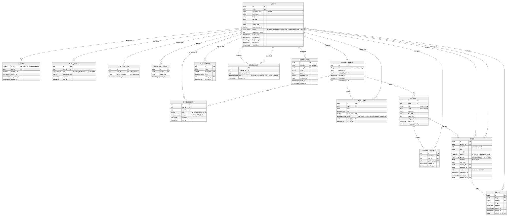
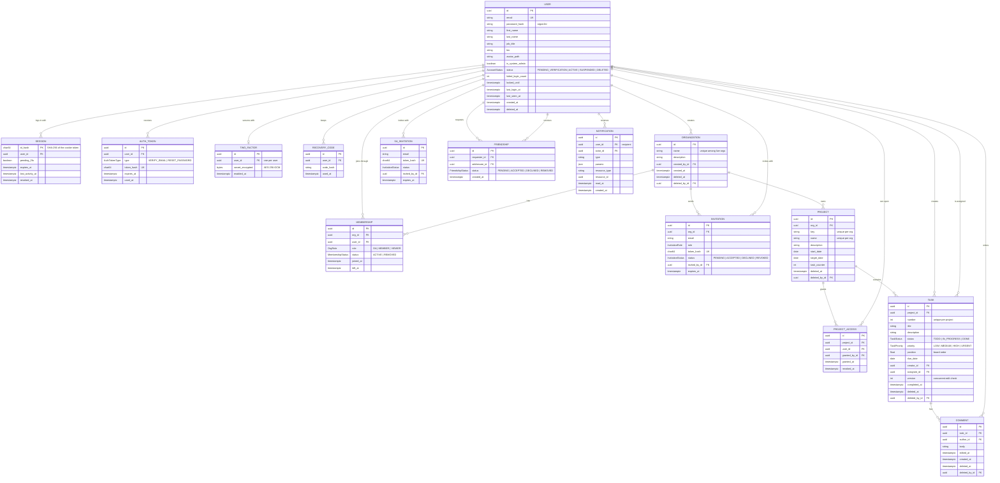

*This project has been created as part of the 42 curriculum by sel-huss, rgedeon, nassaf, mabou-ha.*

# Trenno

## Description

Trenno is a task manager for small teams. A team lives in an **organization**, splits its work into **projects**, and moves **tasks** across a Kanban board. When someone edits a task, drags a card or writes a comment, everyone else looking at the same board sees it right away.

We built it as our ft_transcendence project. The goal was a complete web application that several people can use at the same time without stepping on each other: a React frontend, an Express backend, a PostgreSQL database, all running in Docker behind an HTTPS reverse proxy, started with one command.

What you can do with it:

- **Accounts.** Sign up with email verification, log in and out, reset or change your password, and turn on two-factor authentication with recovery codes. Five wrong passwords lock the account for fifteen minutes.
- **Organizations.** Create one, invite people by email, and give each member a role: Org Admin, Member or Viewer.
- **Projects and tasks.** Projects with per-member access. A board with drag and drop, a task panel with description, assignee, priority, due date and comments. If two people edit the same task at once, the second one is told and sees the latest version instead of overwriting.
- **Real time.** Boards, task panels, comments, notifications, role changes and online status all update over WebSockets. A banner tells you when the connection drops and the page catches up when it comes back.
- **Notifications.** A bell with an unread count and an inbox, fed by every create, update and delete that concerns you. Security events (lockout, password change, 2FA change) also send an email.
- **Search.** Find tasks by text, project, status, priority, assignee and due date, sort them, page through them. The search state lives in the URL so it can be shared.
- **Profiles and friends.** A profile page, an avatar, friend requests inside your organization, and an online/offline status for your friends.
- **Administration.** A System Admin area to see every user and organization, edit them, suspend or delete accounts.
- **Monitoring.** Prometheus scrapes the backend, the host and the database; Grafana shows three dashboards; seven alert rules watch for trouble.

---

## Instructions

### Prerequisites

| Tool | Version |
|---|---|
| Docker Engine | 24 or newer |
| Docker Compose | v2 (`docker compose`, not `docker-compose`) |
| GNU Make | any |
| Google Chrome | latest stable |

Everything else (Node, PostgreSQL, nginx, Prometheus, Grafana) runs in containers.

### 1. Configure `.env`

```bash
cp .env.example .env
```

`.env.example` lists every variable with an empty value. Fill them all in; the stack won't start properly with blanks. The ones that matter most:

| Variable | What it is |
|---|---|
| `POSTGRES_PASSWORD`, `DATABASE_URL` | The database password. It appears in both lines, keep them in sync. |
| `TOTP_ENCRYPTION_KEY` | 32 random bytes, base64 (`openssl rand -base64 32`). Encrypts 2FA secrets. The backend refuses to start without it. |
| `SEED_SA_EMAIL`, `SEED_SA_PASSWORD` | The first System Admin, created when the backend starts. The password must follow the policy (8+ chars, upper, lower, digit, symbol). |
| `SMTP_HOST`, `SMTP_PORT`, `SMTP_USER`, `SMTP_PASS`, `SMTP_FROM`, `SMTP_SECURE` | Where emails go. Sign-up, password reset and invitations all work by email, so point this at an inbox you can read. A Gmail account with an app password works fine. |
| `PROMETHEUS_USER`, `PROMETHEUS_PASSWORD` | Login for the Prometheus UI (nginx basic auth). |
| `GRAFANA_ADMIN_USER`, `GRAFANA_ADMIN_PASSWORD` | Grafana admin login. |

`.env` is in `.gitignore` and is never committed.

### 2. Run

```bash
make          # builds the images and starts everything in the background
```

| URL | What |
|---|---|
| https://localhost:8443 | The app. The certificate is self-signed, accept the warning once. |
| https://localhost:8443/grafana/ | Grafana (login from `.env`). |
| https://localhost:8443/prometheus/ | Prometheus (basic auth from `.env`). |

Only port 8443 is published. Plain HTTP on that port is redirected to HTTPS. Every other service is reachable only on the internal Docker network.

To try it out: log in with `SEED_SA_EMAIL` / `SEED_SA_PASSWORD`. As System Admin you don't belong to any organization, so go to *Admin → Organizations*, create one and invite its first Org Admin by email. Or sign up a normal account and confirm it from the verification email.

### 3. Other commands

| Command | What it does |
|---|---|
| `make down` | Stop everything. |
| `make re` | Rebuild the images and restart. |
| `make logs` | Follow all container logs. |
| `make status` | Container status and health. |
| `make fclean` | Remove containers **and volumes** (database, uploads, certificates). |

---

## Team

| Member | Login | Role(s) | Responsible for |
|---|---|---|---|
| Nicolas Assaf | `nassaf` | Product Owner, Developer | Decides what we build and in which order, keeps the backlog, and checks finished features against the specification. Develops the real-time layer, tasks and comments, notifications and search. |
| Selim-Elie El Husseiny | `sel-huss` | Project Manager, Developer | Runs the planning, the stand-ups and the follow-up, and keeps track of risks and blockers. Develops the Express application, authentication, sessions, 2FA, profiles, organizations, invitations and email. |
| Michel Abou Haidar | `mabou-ha` | Technical Lead, Developer | Chooses the stack, defines the architecture and the database schema, and reviews the critical code. Develops the permissions system and admin panel, projects, Prisma, Docker, nginx and TLS, monitoring and health checks. |
| Rima Gedeon | `rgedeon` | Developer | Develops the whole React frontend: every screen, the UI kit, the API client, the client-side state (auth, real time, notifications) and the responsive layouts. |

---

## Project management

We split the work **by module**, one owner per module (see the Modules table), so nobody was waiting on someone else for the core of their part. The frontend was the exception: Rima built every screen, so each backend owner worked with her on the API shape for their area.

The roles worked like this. Nicolas, as Product Owner, owned the backlog: he decided what went into each two-week plan, what we would cut if we ran late, and whether a finished feature matched the specification. Selim, as Project Manager, ran the daily stand-up and the calls, tracked who was on what, and chased blockers. Michel, as Technical Lead, chose the stack, drew the database schema, set up the repository layout and the Docker stack, and reviewed anything that touched permissions, the schema or the infrastructure.

Before writing code we wrote a requirements specification, [`requirements.md`](requirements.md). Every requirement has an ID (`AUTH-03`, `RT-02`, `NOTIF-01`...) and the code, the issues and the tests refer to them. It also has a "cut order": what we'd drop first if we ran out of time. We did drop the analytics dashboard.

Day to day:

- **GitHub** for the repository, pull requests and issues. Issue titles start with the requirement ID.
- **Feature branches** (`feat/<id>-<name>`), a pull request reviewed by another member, and Conventional Commit messages (`feat(tasks): ...`, `fix(2fa): ...`).
- **Discord** for a short daily written stand-up and quick questions, plus a call every two days.
- A feature counted as done when it worked in the Docker stack, the backend checked permissions and validated input, the page worked at 360 px and in dark mode, the browser console was clean, and someone else had reviewed it.

---

## Technical stack

| Layer | What we used |
|---|---|
| Frontend | React 19, TypeScript, Vite 6, Tailwind CSS 3, dnd-kit (drag and drop), lucide-react (icons), socket.io-client |
| Backend | Node.js 22, Express 4, TypeScript, Socket.IO 4, Zod (validation), argon2 (passwords), otplib + qrcode (2FA), sharp (avatars), Nodemailer (email), prom-client (metrics) |
| Database | PostgreSQL 17 through Prisma 6 |
| Infrastructure | Docker Compose, nginx (TLS and reverse proxy), Prometheus, Grafana, node-exporter, postgres-exporter |

### Why

**React and Tailwind.** The app is mostly interactive screens: a board, side panels, dialogs, menus. React's component model fits that, and Tailwind let one person build a consistent UI kit quickly without maintaining a separate stylesheet.

**Express.** Small and unopinionated, so we could keep a simple layout everywhere: `routes/` handles HTTP, `services/` holds the logic, `schemas.ts` holds the Zod schemas. Every handler does the same four things in order: authenticate, check permissions, validate input, call a service. TypeScript on both sides catches a lot before anything runs.

**PostgreSQL.** The data is relational through and through (users ↔ memberships ↔ organizations ↔ projects ↔ tasks). We wanted transactions for things that must happen together (create an organization *and* make its creator an admin), real constraints, and two features we lean on: advisory locks for the friend-request race and trigram indexes for search.

**Prisma.** One schema file, a generated type-safe client, and every query parameterized. The few raw SQL queries we have (search, the advisory lock) use Prisma's tagged templates, so user input is never concatenated into SQL.

**Sessions in the database rather than JWT.** A session row can be revoked right now: on logout, password reset, suspension or deletion. The cookie is `HttpOnly`, `Secure` and `SameSite=Lax`, and only a SHA-256 hash of the token is stored, so a database leak doesn't hand out live sessions.

**argon2id** for passwords, with a random salt per password and the OWASP-recommended parameters (19 MiB, 2 iterations).

**Socket.IO** rather than raw WebSockets for reconnection and rooms. Each user, organization and project has a room, so an event only reaches the people who are allowed to see it.

**nginx** as the single entry point: TLS termination (TLS 1.2/1.3, self-signed certificate generated on first start), security headers, and routing for `/`, `/api`, `/socket.io`, `/grafana` and `/prometheus`.

### How the API answers

Two conventions worth knowing when you read the code or test with curl:

- A request that is well-formed but refused by the current state - wrong password, name already taken, invitation link already used, task edited by someone else - answers **`200` with `{ ok: false, error: { code, message } }`**. The frontend treats it as an error and shows the message. We chose this so that expected refusals don't show up as errors in the browser console, the network tab or the Prometheus error-rate panel.
- Missing authentication is a real `401`, and something actually broken is a `500`.

Validation errors come back the same way, with Zod's details, for example `{ ok: false, error: { code: "VALIDATION_ERROR", ... } }`.

### Architecture

```
Browser ── HTTPS / WSS :8443 ──▶ nginx ──┬── /                    ▶ frontend  (nginx serving the React build)
                                          ├── /api, /socket.io     ▶ backend   (Express + Socket.IO) ── Prisma ──▶ db (PostgreSQL 17)
                                          ├── /grafana             ▶ grafana   ◀── prometheus ◀── backend /metrics, node-exporter, postgres-exporter
                                          └── /prometheus (auth)   ▶ prometheus
```

---

## Database schema

The schema is [`apps/backend/prisma/schema.prisma`](apps/backend/prisma/schema.prisma); the SQL with the partial unique indexes is in [`db/init.sql`](db/init.sql). Every primary key is a UUID, every timestamp is `timestamptz`.



<details>
<summary>Diagram source (Mermaid)</summary>



</details>

| Table | Key fields | Notes |
|---|---|---|
| `user` | `id` uuid, `email` unique, `password_hash` (argon2id), `first_name`, `last_name` varchar(50), `job_title`, `bio`, `avatar_path`, `is_system_admin` bool, `status` enum (PENDING_VERIFICATION / ACTIVE / SUSPENDED / DELETED), `failed_login_count` int, `locked_until`, `last_login_at`, `last_seen_at`, `deleted_at` | An account. Soft-deleted. |
| `session` | `id_hash` char(64) PK, `user_id` → user, `pending_2fa` bool, `expires_at`, `last_activity_at`, `revoked_at` | One login. Only the hash of the cookie value is stored. |
| `auth_token` | `user_id` → user, `type` (VERIFY_EMAIL / RESET_PASSWORD), `token_hash` unique, `expires_at`, `used_at` | Single-use email links. |
| `two_factor` | `user_id` → user (unique), `secret_encrypted` bytes (AES-256-GCM), `enabled_at` | TOTP secret. `enabled_at` is null until the first valid code. |
| `recovery_code` | `user_id` → user, `code_hash`, `used_at` | Ten single-use codes, stored hashed. |
| `organization` | `name` varchar(100), `description`, `created_by_id` → user, `deleted_at`, `deleted_by_id` | A workspace. Soft-deleted. Name unique among live orgs. |
| `membership` | `org_id` → organization, `user_id` → user, `role` (OA / MEMBER / VIEWER), `status` (ACTIVE / REMOVED), `joined_at`, `left_at` | A user's role in an org. One active membership per user. |
| `invitation` | `org_id` → organization, `email`, `role`, `token_hash` unique, `status` (PENDING / ACCEPTED / DECLINED / REVOKED), `invited_by_id` → user, `expires_at` | Valid for 7 days, one pending per org and email. |
| `sa_invitation` | `email`, `token_hash`, `status`, `invited_by_id` → user, `expires_at` | Invitation to become a System Admin. |
| `friendship` | `requester_id` → user, `addressee_id` → user, `status` (PENDING / ACCEPTED / DECLINED / REMOVED) | One row per pair. |
| `project` | `org_id` → organization, `key` varchar(6), `name`, `description`, `start_date`, `target_date`, `task_counter` | Soft-deleted. Key and name unique per org. |
| `project_access` | `project_id` → project, `user_id` → user, `granted_by_id`, `revoked_at` | Who can open a project. |
| `task` | `project_id` → project, `number`, `title` varchar(200), `description`, `status` (TODO / IN_PROGRESS / DONE), `priority` (LOW…URGENT), `position` float, `due_date`, `assignee_id` → user, `creator_id` → user, `version` int | `number` is unique per project (`KEY-12`). `version` detects concurrent edits. Trigram indexes on title and description for search. |
| `comment` | `task_id` → task, `author_id` → user, `body` varchar(5000), `edited_at` | Soft-deleted. |
| `notification` | `user_id` → user, `actor_id` → user, `type`, `params` json, `resource_type`, `resource_id`, `read_at` | Indexed for the inbox query. |

Business data is never `DELETE`d. "Delete" sets `deleted_at`, so a deleted task still shows up in history and a deleted user still appears as "Deleted user" on their old comments.

---

## Features

| Feature | What it does | Who |
|---|---|---|
| Sign-up and email verification | The account starts as *pending*; a single-use link (24 h) activates it. The response is the same whether or not the email is already taken, so it can't be used to find accounts. | Selim (API), Rima (UI) |
| Login and logout | Database session, 7 days, 12-hour idle timeout, secure cookie. Logout deletes the session and closes its WebSocket connections. | Selim, Rima |
| Lockout and rate limiting | 5 wrong passwords lock the account for 15 min and send an email. 10 login attempts per minute per IP. | Selim |
| Password reset and change | Reset link valid 30 min, single use, revokes every session. Change needs the current password. Both send a confirmation email. | Selim, Rima |
| Two-factor authentication | QR code setup, enabled only once a code is verified, 10 hashed recovery codes, a 5-minute pending session for the second step, 5 attempts, disable with password + code. | Selim (API), Rima (UI) |
| Profile and avatar | Name, job title, bio. Avatar upload (JPEG/PNG/WebP, 2 MB), checked by its real bytes and re-encoded to 256×256 WebP. Initials when there's no avatar. | Selim, Rima |
| Friends and online status | Friend requests within an organization; online/offline with "last seen", visible to friends only. | Selim (API), Nicolas (presence), Rima (UI) |
| Profile pages | `/users/:id`, visible to people in the same organization. | Selim, Rima |
| Organizations | Create (creator becomes Org Admin), edit, delete with typed confirmation. Deleting emails every member. | Selim, Rima |
| Invitations | Invite by email with a role, resend, revoke. A link works once and expires after 7 days. Works for new and existing accounts. | Selim, Rima |
| Members and roles | Change Member ↔ Viewer, remove a member, leave. The last Org Admin can't leave. | Selim (API), Rima (UI) |
| Permissions and admin panel | Four roles (System Admin, Org Admin, Member, Viewer) with different screens and actions. The admin area lists, edits, suspends and deletes users, and manages organizations. | Michel (API), Rima (UI) |
| Projects | Projects with a key, dates and an access list; grant and revoke access. | Michel (API), Rima (UI) |
| Tasks and comments | Kanban board with drag and drop (mouse, touch and keyboard), task panel, assignees, priorities, due dates, comments. Card order and concurrent edits are handled server-side. | Nicolas (API), Rima (UI) |
| Real-time updates | Socket.IO rooms per user, organization and project. Live boards, comments, role changes, presence, and a reconnect banner. | Nicolas (server), Rima (client) |
| Notifications | Bell, unread count and inbox for create/update/delete events, pushed live; emails for security events. | Nicolas (API), Rima (UI) |
| Search | Text, project, status, priority, assignee and due-date filters; five sort keys; pagination; state kept in the URL. | Nicolas (API), Rima (UI) |
| Monitoring | `/metrics` on the backend; Prometheus with 4 targets and 7 alert rules; 3 provisioned Grafana dashboards; both behind nginx with credentials. | Michel |
| Health check | `GET /api/v1/health` reports the database; Docker health checks on every container. | Michel |
| UI kit | Tailwind theme (colors, fonts, dark mode) and about twenty reusable React components. | Rima |
| Legal pages | Privacy Policy and Terms of Service written for this app, linked from every footer and the sign-up form. | Rima |
| HTTPS and deployment | nginx with TLS, security headers, one-command Docker deployment. | Michel |

---

## Modules

| # | Module | Type | Points | Owner |
|---|---|---|--:|---|
| 1 | Use a framework for both the frontend and backend (React + Express) | Major | 2 | Rima (React), Selim (Express) |
| 2 | Standard user management and authentication | Major | 2 | Selim |
| 3 | Advanced permissions system | Major | 2 | Michel |
| 4 | Organization system | Major | 2 | Selim (organizations, invitations), Michel (projects), Nicolas (tasks) |
| 5 | Real-time features using WebSockets | Major | 2 | Nicolas (server), Rima (client) |
| 6 | Monitoring with Prometheus and Grafana | Major | 2 | Michel |
| 7 | Use an ORM (Prisma) | Minor | 1 | Michel |
| 8 | Notification system for creation, update and deletion actions | Minor | 1 | Nicolas (API), Rima (UI) |
| 9 | Advanced search with filters, sorting and pagination | Minor | 1 | Nicolas (API), Rima (UI) |
| 10 | Complete 2FA system | Minor | 1 | Selim |
| 11 | Custom design system with reusable components | Minor | 1 | Rima |
| | **Total: 6 Major + 5 Minor** | | **17** | |

The subject asks for 14. The extra 3 are our margin.

### Why these modules, and how each one works

**1. React + Express.** We already knew JavaScript and TypeScript, and a single-page app talking to a REST and WebSocket API is exactly what these two are made for. The frontend is in `apps/frontend`, the backend in `apps/backend`: `index.ts` starts the server, `app.ts` wires the middleware and one router per area.

**2. User management.** Accounts are the foundation of everything else. Sign-up, verification, login, sessions, lockout, password reset and change are in `routes/auth.ts` and `services/auth.ts`. Profiles, avatars, friends and profile pages are in `routes/users.ts`, `services/avatars.ts` and `services/friends.ts`. Online status comes from the Socket.IO presence tracker.

**3. Advanced permissions.** A team tool is useless without roles. The role is computed from the session on every request (System Admin, Org Admin, Member, Viewer); each endpoint enforces the matrix in the spec, and the UI changes with it: Viewers get a read-only board, the admin area only exists for a System Admin. The admin panel is `routes/admin.ts` and `pages/Admin*.tsx`.

**4. Organizations.** This is what Trenno is: projects, tasks and members all live inside an organization. Creating one and making its creator an Org Admin is a single transaction (`routes/onboarding.ts`). Edit, delete, role changes and removals are in `services/orgs.ts`; invitations in `services/invitations.ts`. Invitation tokens are hashed and claimed atomically, so a link really works only once even if you double-click. What members do inside the organization lives in `routes/projects.ts` and `services/projects.ts` (projects and access lists) and `routes/tasks.ts` and `services/tasks.ts` (tasks, card order, comments, and the version check that catches two people editing the same task).

**5. Real time.** Several people edit the same board, so changes have to show up without reloading. `realtime/socket.ts` authenticates the socket with the same session cookie as HTTP and puts it in rooms per user, organization and project. The board listens, batches events over 100 ms and refreshes. A 10-second grace period stops the online status flickering on reload, and the reconnect banner appears when the connection drops.

**6. Monitoring.** We wanted to see what the app was doing during the defense, not just hope. `prom-client` exposes `/metrics` (request counts and latency per route, WebSocket connections, Node runtime). Prometheus scrapes it plus node-exporter and postgres-exporter and evaluates 7 rules in `prometheus/alert.rules.yml` (service down, 5xx rate, p95 latency, CPU, memory, DB connections). Grafana's datasource and three dashboards are provisioned from `grafana/`, so a fresh stack has them with no clicking.

**7. Prisma.** One schema file, a generated client, parameterized queries. `schema.prisma` is applied when the backend container starts.

**8. Notifications.** You shouldn't have to watch every board. One helper, `notify()` in `services/notifications.ts`, is called from every create, update and delete that has an audience: tasks, comments, projects, organizations, memberships, invitations, friend requests, and account security events. It writes the rows, pushes them to the bell over the socket, and the inbox API lets you read, mark and delete them. Purely personal actions (editing your own profile) notify nobody, since there's nobody else to tell.

**9. Search.** Organizations accumulate hundreds of tasks. `routes/search.ts` validates the query with a strict Zod schema, builds parameterized SQL with the filters and sort, pages 25 at a time with a stable order, and only returns tasks from projects the caller can open. Trigram indexes keep the `ILIKE` fast.

**10. 2FA.** Protects an account whose password leaked. The TOTP secret is generated on our server, shown as a QR code, and stored encrypted with AES-256-GCM. 2FA only turns on once a valid code is entered. Ten recovery codes are stored hashed. A login with 2FA creates a 5-minute pending session that can't do anything until the second step succeeds. `services/twoFactor.ts`, `routes/auth.ts`.

**11. Design system.** Twenty-odd screens by one person needed a kit. `tailwind.config.js` holds the color scales, fonts (Plus Jakarta Sans, JetBrains Mono) and dark mode; `apps/frontend/src/components/` holds the reusable pieces (Button, IconButton, Input, Textarea, Select, Checkbox, Field, Modal, FormDialog, ConfirmDialog, Tabs, Menu, Toast, Alert, Badge, Avatar, Card, EmptyState, PageHeader, Spinner, ...). Icons are lucide-react. Every page is built from these.

---

## Individual contributions

### Nicolas (nassaf) - Product Owner; r0eal time, tasks, notifications, search

- Owned the backlog and the two-week plans, and validated each feature against `requirements.md` before it was merged.
- The Socket.IO server (`realtime/socket.ts`): authenticating the socket with the session cookie, rooms per user, organization and project, forced disconnect when a session is revoked, and the presence tracker.
- Tasks and comments (`routes/tasks.ts`, `services/tasks.ts`): create, edit, move, assign, delete, comments, the card ordering, the live events, and the version check that refuses an edit made on a stale copy.
- The notification service (`notify()`, audience resolution, live push) and the inbox API (`routes/notifications.ts`, `services/notifications.ts`), wired into every route that creates, updates or deletes something.
- Search (`routes/search.ts`): the query schema, the parameterized SQL with filters, sorting and pagination, and access scoping.

What was hard: online status flickered every time someone reloaded a page, because the socket disconnected and reconnected within a second; a 10-second grace period before announcing "offline" fixed it. Card ordering on the board: positions are floats and a moved card takes the midpoint of its neighbours, so after enough moves the gap runs out - the column is renumbered inside the same transaction when that happens. And deciding who should be told about what: a comment interests the task's assignee and creator, not the whole organization, so every event type goes through a small audience rule.

### Selim (sel-huss) - Project Manager; backend, accounts, organizations, 2FA

- Ran the stand-ups and calls, kept the issue board current, and chased blockers.
- Set up the Express application (`app.ts`, `index.ts`): middleware, the `routes/` → `services/` split, the error format, the shared Zod schemas (`schemas.ts`), and the email service (`services/mailer.ts`).
- Authentication end to end: sign-up, email verification, login/logout, database sessions with hashed tokens, lockout, rate limiting, password reset and change, and the "same answer whether or not the email exists" rule.
- The user API: profile editing, avatar upload with magic-byte checks and sharp re-encoding, friends, profile pages.
- Organizations and invitations: create, edit, soft delete, invitations (organization and System Admin), role changes, removal, leaving, and the "last Org Admin can't leave" guard.
- The 2FA flow with encrypted secrets and recovery codes.

What was hard: double-clicking an invitation link used it twice, fixed with an atomic claim inside a transaction. Two quick clicks created two friend requests, fixed with a PostgreSQL advisory lock on the sorted pair of user ids. And keeping sign-up and reset from revealing which emails have accounts: both always answer the same thing.

### Michel (mabou-ha) - Technical Lead; permissions, projects, database, infrastructure, monitoring

- Chose the stack, designed the database schema (`prisma/schema.prisma`, `db/init.sql` with the partial unique indexes), set up Prisma and the seed, and reviewed the code that touches permissions, the schema or the infrastructure.
- The permissions system and the System Admin panel (`routes/admin.ts`): list, edit, suspend, reactivate, delete users; manage organizations.
- Projects (`routes/projects.ts`, `services/projects.ts`): create, edit, delete, and the access list.
- Docker Compose, the backend and frontend images and entrypoints, nginx with TLS and security headers, the Makefile, `.env.example`.
- Monitoring: the metrics middleware (`services/metrics.ts`), Prometheus and its alert rules, the three Grafana dashboards, the exporters.
- Health checks on every container and the `/api/v1/health` endpoint.

What was hard: postgres-exporter 0.16 queries `pg_stat_bgwriter` columns that PostgreSQL 17 moved to `pg_stat_checkpointer`, which filled the logs with errors until that collector was disabled. And serving the app, Grafana and Prometheus from one HTTPS port: Grafana under a sub-path, WebSocket upgrades for Socket.IO, basic auth on Prometheus, and security headers that don't break any of them.

### Rima (rgedeon) - Developer; the whole frontend

- Every screen in the app (`src/pages/`): auth popups, onboarding, organization and member pages, the project board and list views, the task panel, search, notifications, the admin area, the profile pages, the legal pages.
- The UI kit (`src/components/`), the Tailwind theme, dark mode, and the responsive layouts (drawer sidebar, mobile header, horizontally scrolling board).
- The API client (`src/api/`) and the client-side state (`src/context/`): auth, the Socket.IO connection with the reconnect banner, and the live notification bell.
- Drag and drop with dnd-kit, including keyboard and touch.

What was hard: drag and drop on phones. The mouse sensor stole every touch, so scrolling the board started a drag. The fix was separate sensors - a small distance threshold for the mouse, a 250 ms hold for touch - plus a "Move to" menu for anyone who can't drag. The mobile header, sidebar and dropdowns took several rounds at 360 px before nothing overflowed.

---

## Resources

### References

- [Express](https://expressjs.com/), [React](https://react.dev/), [Vite](https://vite.dev/), [Tailwind CSS](https://tailwindcss.com/docs)
- [Prisma](https://www.prisma.io/docs), [PostgreSQL](https://www.postgresql.org/docs/) (transactions, advisory locks, `pg_trgm`)
- [Socket.IO](https://socket.io/docs/v4/), [dnd-kit](https://docs.dndkit.com/), [Zod](https://zod.dev/)
- [OWASP Password Storage Cheat Sheet](https://cheatsheetseries.owasp.org/cheatsheets/Password_Storage_Cheat_Sheet.html) (argon2id parameters) and [Session Management Cheat Sheet](https://cheatsheetseries.owasp.org/cheatsheets/Session_Management_Cheat_Sheet.html)
- [RFC 6238 - TOTP](https://datatracker.ietf.org/doc/html/rfc6238)
- [Prometheus](https://prometheus.io/docs/), [Grafana provisioning](https://grafana.com/docs/grafana/latest/administration/provisioning/), [nginx](https://nginx.org/en/docs/)

### How we used AI

We used an AI assistant (Claude) as a coding helper for small, repetitive tasks and to help diagnose a few specific bugs, such as the postgres-exporter errors against PostgreSQL 17 and the empty environment BusyBox `crond` gives its jobs. It also helped put this README into shape from our notes. All application code was written, tested and understood by the team.

---

## Known limitations

- The login rate limiter and the 2FA attempt counter live in memory. They reset when the backend restarts and wouldn't be shared between several backend instances.
- A TOTP code can be reused within its 30-second window.
- The TLS certificate is self-signed; browsers warn once.
- Refusals (wrong password, name taken, edit conflict) answer `200 { ok: false }` rather than a 4xx. This is deliberate (see "How the API answers") but unusual.
- Emails need a real SMTP server. There is no built-in test inbox.
